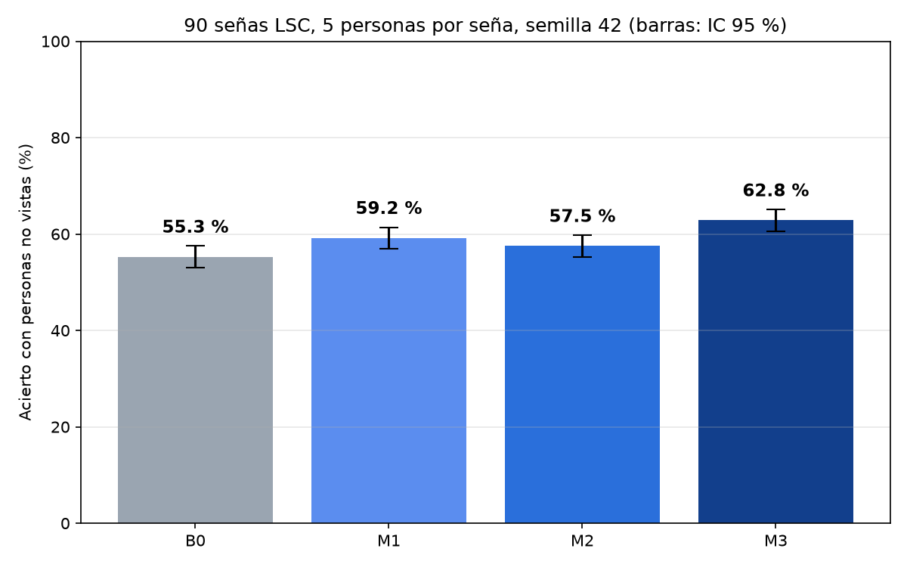

# LSC 4 versiones: cómo mejora un reconocedor de Lengua de Señas Colombiana

Este repositorio compara **4 versiones** de un reconocedor de señas de la **Lengua de Señas Colombiana (LSC)**, de la más sencilla a la más completa. Cada versión agrega algo a la anterior.

Con lo que hay aquí cualquier persona puede:
1. **Repetir el experimento** y obtener exactamente las mismas tablas y gráficas.
2. **Probar cada versión en vivo** con la cámara del computador, haciendo señas como una persona nueva.
3. **Usar la app del celular**: ver las 90 señas una a una e intentarlas con cualquiera de las 4 versiones.

---

## Las 4 versiones

| Versión | Qué ve | Acierto con personas nuevas |
|---|---|---|
| **1. Solo manos** | Los 21 puntos de cada mano (MediaPipe Hand Landmarker), cuadro a cuadro, con una red GRU. Es la **línea base** que se usa en el estado del arte. | 55,3 % |
| **2. Manos + cuerpo** | Lo de la 1 **+ las muñecas y los codos**, y todo medido desde los hombros (no importa dónde esté la persona ni qué tan lejos). | 59,2 % |
| **3. Dibujo + lugar + dedos** | La seña como un **dibujo** (el recorrido de la mano), **dónde ocurre** respecto al cuerpo y la cara, y la **forma de los dedos** al inicio, a la mitad y al final. | 57,5 % |
| **4. Fusión 2 + 3** | La versión 2 y la 3 **votan juntas**. | **62,8 %** |



- **1 → 2:** mejora significativa (+3,9; prueba de McNemar p = 0,0001).
- **2 vs 3:** sin diferencia significativa (p = 0,17). La 3 acierta más **entre las 3 primeras opciones** (73,5 % contra 70,7 %).
- **4:** la mejor. Supera a la 2 (+3,6; p = 0,0002) y a la línea base (+7,5; p < 0,0001).

Detalle completo en [`BITACORA_experimento.md`](BITACORA_experimento.md).

---

## Los datos

- **90 señas** de los datasets oficiales **LSC50** y **LSC-54**.
- **5 personas por seña × 4 muestras = 20 muestras por seña, 1800 en total**, todas iguales para que la comparación sea justa.
- La lista de las 90 señas, con su dataset de origen, sus 5 personas y sus 20 archivos, está en [`lista_90_senas.csv`](lista_90_senas.csv).
- Las muestras están en `dataset 90 senas/`, una carpeta por seña con su nombre (`00_GRACIAS` … `89_VERDE`).
- Cada muestra tiene los puntos de MediaPipe (manos, muñecas, codos, hombros y 11 puntos de la cara) en 99 cuadros.

**Cómo se evalúa:** 5 vueltas **dejando una persona por fuera**. En cada vuelta se entrena con 4 personas por seña (1260 entrenamiento + 180 validación) y se prueba con la persona que falta (360 pruebas). Así cada una de las 1800 muestras se prueba **una sola vez** y siempre con alguien que el modelo **nunca vio**. Semilla fija: **42**.

> **Cita los datasets originales** (LSC50 y LSC-54) en cualquier trabajo que use estos datos.

---

## Paso a paso (Windows)

### 0. Lo que necesitas instalar (una sola vez)
1. **Python 3.11**: https://www.python.org/downloads/ (en la instalación marca *"Add Python to PATH"*).
2. **Git**: https://git-scm.com/downloads, o descarga este repositorio como ZIP (botón verde *Code → Download ZIP*).
3. Recomendado: una **tarjeta NVIDIA** (sin ella funciona, pero el experimento tarda bastante más).

### 1. Descargar el repositorio
```bash
git clone https://github.com/rolandramirez491/lsc-4-versiones.git
```
```bash
cd lsc-4-versiones
```

### 2. Crear el entorno e instalar las librerías
```bash
python -m venv .venv
```
```bash
.venv\Scripts\activate
```
Con tarjeta NVIDIA:
```bash
pip install torch==2.7.1 --index-url https://download.pytorch.org/whl/cu118
```
Sin tarjeta NVIDIA:
```bash
pip install torch==2.7.1
```
Y el resto:
```bash
pip install -r requirements.txt
```

### 3. Repetir el experimento y comparar
```bash
reproducir.bat
```
Hace todo en orden:
1. Muestra si tu computador tiene las mismas versiones y la misma tarjeta que el original.
2. Comprueba con huellas SHA-256 que los datos y las 1800 muestras son los originales.
3. Entrena y prueba las 4 versiones (unos 25 minutos con GPU).
4. Compara tus 1800 predicciones con las originales y dice si son idénticas.

Tus gráficas y tablas quedan en `resultados/`. Las originales están en `resultados_referencia/`.

### 4. Probar cada versión en vivo con la cámara
```bash
probar_en_vivo.bat
```
1. A la derecha está la **seña que hay que intentar**: el video real (en las 50 de LSC50), con lo que ve la versión dibujado encima. Con **← →** cambias de seña.
2. Ponte frente a la cámara (que se vean la cara, los hombros y las manos). Encima de la cámara se dibuja **solo lo que ve la versión elegida**:
   - **Versión 1:** los 21 puntos de cada mano, tal cual los da MediaPipe.
   - **Versión 2:** lo mismo, más los hombros, codos y muñecas.
   - **Versión 3:** las manos, el trazo de la palma, el trazo del codo y los lugares de la cara y el pecho.
   - **Versión 4:** todo.
3. **Abre la boca:** empieza a grabar. Haz la seña y **baja las manos:** termina (o a los 5 segundos).
4. La cámara se va y queda el **resultado**: si acertaste, en qué puesto quedó tu seña y con qué %, y las **4 más parecidas** con el % de cada parte de la versión.
5. Teclas **1, 2, 3, 4** para cambiar de versión (la misma seña se vuelve a evaluar), **ESPACIO** para intentar otra vez y **ESC** para salir.

### 5. App del celular (Android)
1. Descarga `LSC-4-versiones.apk` desde la página de **[Releases](https://github.com/rolandramirez491/lsc-4-versiones/releases)**.
2. Ábrelo en el celular y acepta *"instalar apps de origen desconocido"*. Es una app aparte: no reemplaza ninguna otra.
3. En la app:
   - Elige una de las **4 versiones**.
   - **MOSTRAR SEÑAS:** las 90 señas, una a una, con el muñeco (sin espejo, de frente), y en las 50 de LSC50 también el video real. Encima del video y del muñeco se dibuja lo que ve la versión elegida (V1–V4).
   - **INTENTAR SEÑA:** abre la cámara y dibuja encima solo lo que ve la versión. Abre la boca, haz la seña y baja las manos. La cámara se va y queda el resultado: si acertaste, en qué puesto quedó tu seña y las 4 más parecidas con el % de cada parte. **INTENTAR OTRA VEZ** vuelve a la cámara, **◀ VOLVER A LAS SEÑAS** regresa, y si cambias de versión (V1–V4) la misma seña se vuelve a evaluar.

---

## ¿Saldrá exactamente igual?

- **Mismo computador, mismas versiones y misma tarjeta:** sí, **idéntico**. Se comprobó dos veces: las 1800 predicciones de las 4 versiones coincidieron una por una.
- **Otro computador:** todo es determinista (semilla 42, modo determinista de PyTorch y cuDNN), pero otra tarjeta u otras versiones de las librerías pueden cambiar **décimas**. `reproducir.bat` te muestra qué es distinto.
- **El banco de datos:** si se rehace desde los datasets oficiales, las 1800 muestras salen **idénticas** número por número (comprobado).
- **Celular vs. computador:** el cálculo del celular (Kotlin) da lo mismo que Python en las secuencias, los trazos y las medidas (diferencias de 10⁻⁷, ver `android/app/src/test`). La única diferencia es cómo se **pinta** el dibujo de la versión 3: el celular no tiene OpenCV. En las 1800 muestras la versión 3 da **la misma respuesta en el 99,1 %** de los casos.

---

## Rehacer el banco desde cero (opcional)

No hace falta para repetir el experimento: el banco ya viene incluido y verificado.
1. Descarga `lsc50_landmarks_60frames.npz` desde **Releases** y ponlo en `datos_originales/`.
2. Consigue el `datos.json` del dataset **LSC-54** (52 GB) de su fuente oficial.
3. Ejecuta:
```bash
reproducir.bat "C:\ruta\a\datos.json"
```
Rehace las 1800 muestras y comprueba que son idénticas a las incluidas.

Los scripts que convirtieron los landmarks oficiales de LSC50 al archivo `.npz` están en `origen_lsc50/`.

---

## Qué hay en cada carpeta

| Carpeta / archivo | Para qué sirve |
|---|---|
| `dataset 90 senas/` | Las 1800 muestras (90 señas). `seleccion.json` dice qué se escogió y con qué semilla. |
| `lista_90_senas.csv` | Las 90 señas con sus personas y archivos. |
| `codigo/experimento_4.py` | El experimento de las 4 versiones. |
| `codigo/versiones.py` | Entrena las 4 versiones con todo el banco y las usa en vivo. |
| `codigo/probar_en_vivo.py` | Programa de la cámara del computador. |
| `codigo/experimento_versiones.py` | El experimento ampliado: 17 variantes (anexo). La versión 2 es la V4 y la 3 es la V14. |
| `codigo/crear_dataset_90.py` | Arma el banco desde LSC50 y LSC-54. |
| `codigo/verificar.py` | Huellas SHA-256, entorno y comparación de resultados. |
| `codigo/exportar_celular.py` | Pasa las 4 versiones al celular (ONNX) y genera los casos de prueba. |
| `modelos/` | Las 4 versiones ya entrenadas y el modelo de MediaPipe. |
| `resultados_referencia/` | Los resultados originales, incluida la predicción de cada muestra. |
| `android/` | La app del celular (proyecto de Android Studio). |
| `huellas.json`, `entorno_original.json` | Para comprobar que los datos y el entorno son los originales. |
| `BITACORA_experimento.md` | Qué se hizo, cómo, los resultados y los límites. |

---

## Límites
- Solo 5 personas por seña: la variación entre personas es grande (±11–13 puntos), aunque las comparaciones son significativas.
- En LSC-54 las 5 personas de prueba cambian de una seña a otra.
- Los datasets son de estudio (la mano siempre se ve y los clips vienen recortados). Con la cámara de un celular o un computador los resultados pueden ser distintos.
